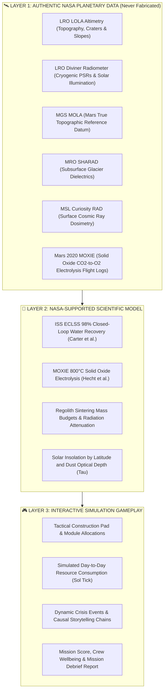

# 🚀 OUTPOST: Junior Astronaut Mission Trainer

> **NASA Space Apps Challenge 2026** — *Junior Astronaut Mission Trainer*  
> *"Build smart. Survive longer. Discover more."* • *"বিজ্ঞান ও সিদ্ধান্তের শক্তিতে মহাশূন্যে টিকে থাকা।"*

[](https://outpost-app.vercel.app/)
[](./TESTING.md)
[](https://threejs.org/)
[](https://react.dev/)
[](https://tailwindcss.com/)
[](https://www.spaceappschallenge.org/)
[](./public/manifest.json)
[](#-bilingual-localization-system-বাংলা--english)
[](./ASSET_LICENSES.md)

---

## 🌐 Live Application & Links
- **Official Live Web Application:** [https://outpost-app.vercel.app/](https://outpost-app.vercel.app/)
- **GitHub Repository:** [https://github.com/jihadjp/nasa-junior-astronaut-trainer](https://github.com/jihadjp/nasa-junior-astronaut-trainer)
- **NASA Space Apps Challenge 2026 Submission:** Junior Astronaut Mission Trainer

---

## 📖 Table of Contents
1. [Project Overview & Core Educational Philosophy](#1-project-overview--core-educational-philosophy)
2. [What Makes OUTPOST Game-First?](#2-what-makes-outpost-game-first)
3. [The 3-Layer NASA Data Architecture](#3-the-3-layer-nasa-data-architecture)
4. [Authentic NASA Planetary Datasets & Treks Integration](#4-authentic-nasa-planetary-datasets--treks-integration)
5. [Key Systems & Game Features](#5-key-systems--game-features)
6. [Interactive STEM Training Academy (8 Simulation Labs)](#6-interactive-stem-training-academy-8-simulation-labs)
7. [In-Game Tactical Keyboard Controls & Pause System](#7-in-game-tactical-keyboard-controls--pause-system)
8. [Autonomous Rover Sortie & ECLSS Mass Balance](#8-autonomous-rover-sortie--eclss-mass-balance)
9. [Bilingual Localization System (বাংলা ↔ English)](#9-bilingual-localization-system-বাংলা--english)
10. [Mobile-First PWA Architecture](#10-mobile-first-pwa-architecture)
11. [Technology Stack](#11-technology-stack)
12. [Installation & Local Setup](#12-installation--local-setup)
13. [Automated Test Suite (18/18 Passing)](#13-automated-test-suite-1818-passing)
14. [NASA Scientific Citations & Compliance](#14-nasa-scientific-citations--compliance)
15. [License](#15-license)

---

## 1. Project Overview & Core Educational Philosophy

**OUTPOST: Junior Astronaut Mission Trainer** is an authentic, browser-based space systems engineering and life-support survival simulation game built for the **NASA Space Apps Challenge 2026**.

The application places students and young learners in the commander's seat of an off-world research base situated on either the **Moon (Artemis Base Camp / Lunar South Pole)** or **Mars (Ares Colony / Gale Crater / Olympus Mons)**.

### 🎯 The Core Educational Principle
> **"Every engineering decision has physical consequences."**

In deep space exploration, launch mass from Earth is strictly constrained, solar power varies with planetary tilt and dust opacity ($\tau$), and life support loops must approach complete closure. Players must balance competing trade-offs between:
- **Oxygen ($O_2$) & Water ($H_2O$) closed-loop recycling**
- **Photovoltaic Generation & Energy Storage during 354-hour lunar nights**
- **Regolith Radiation Shielding against Galactic Cosmic Rays (GCR) and Solar Particle Events (SPE)**
- **Hydroponic Crop Production & Photosynthetic Spectrum Tuning**
- **Crew Psychological Morale, Cognitive Health & Hypoxia Prevention**
- **In-Situ Spare Parts 3D Fabrication vs Launch Payload Budgets**
- **Autonomous Surface Rover Sorties & Planetary Science Output**

---

## 2. What Makes OUTPOST Game-First?

Unlike traditional educational dashboards or text-heavy NASA documentation websites, OUTPOST is designed **Game First, Science Grounded, Text Last**:

- 🌌 **Real-Time 3D WebGL World (Three.js):** Cinematic, real-time 3D planetary environments featuring procedural crater topography, sun-tracking solar arrays, illuminated modular habitats, roaming surface rovers, grounded EVA astronauts, and a slowly spinning Earth.
- 🕹 **Tactical Base Construction Pad:** Coordinate grid construction pad with animated energy and life-support conduit pulses connecting modules.
- 🚨 **Visual Consequence Feedback:** Habitat viewports brown out to emergency amber/red when electrical power drops below 25%, rotating red alert beacons trigger during crises, and atmospheric dust storm veils sweep across Mars.
- 🎮 **Tactical In-Game Pause Menu & Hotkeys:** Instant keyboard controls (`Space` to advance Sol, `1/3` simulation speed, `C` crew, `R` rover sortie, `V` vitals, `Esc/P` tactical pause).
- 📜 **Official NASA Artemis Cadet Certificate:** High-resolution printable diploma with live student CallSign, score percentage, specialist badges, and celebratory confetti.

---

## 3. The 3-Layer NASA Data Architecture

To maintain rigorous scientific accuracy while delivering high-engagement gameplay, OUTPOST strictly enforces the **Three-Layer Separation Rule**:



1. **Layer 1 (Real NASA Data):** Real landing coordinates, planetary elevations, terrain slopes, thermal ranges, and cosmic ray background levels sourced directly from NASA missions. **Never fabricated.**
2. **Layer 2 (Scientific Model):** Real-world chemical, biological, and engineering transfer functions derived from published NASA papers (e.g., $0.84\text{ kg } O_2/\text{crew}/\text{day}$, $2.5\text{ kg } H_2O/\text{crew}/\text{day}$, $98.4\%$ water loop recovery).
3. **Layer 3 (Educational Simulation):** Player gameplay variables, tactical choices, and base states. The game transparently communicates to learners that simulated bars reflect their management decisions, not live spacecraft feeds.

---

## 4. Authentic NASA Planetary Datasets & Treks Integration

OUTPOST integrates data and portal connections directly from **NASA Solar System Treks** ([trek.nasa.gov](https://trek.nasa.gov/)) and the **NASA Planetary Data System (PDS)**:

| Planetary Instrument | NASA Dataset Identifier | Real Parameter Utilized | Gameplay Consequence |
| :--- | :--- | :--- | :--- |
| **LRO LOLA** | `LDEM_128 / SLDEM2015` | Elevation (km) & Crater Slope (deg) | Higher slope increases habitat anchoring cost & spare parts consumption. |
| **LRO Diviner** | `DLRE Cumulative Illumination` | Polar Grazing Sunlight (86–90%) & PSR Temps (-246°C) | Continuous power bonus at Peak of Eternal Light; eliminates 14-day night blackout. |
| **MGS MOLA** | `MEGDR_128 Gridded Topography` | True Martian elevations relative to 6.1 mbar datum | Regolith leveling difficulty & atmospheric pressure variations. |
| **MRO SHARAD** | `Subsurface Radar Soundings` | 1.5–2.5m shallow ice sheets (Arcadia Planitia) | Unlocks +40% in-situ water extraction bonus. |
| **MSL RAD** | `MSL Calibrated Dose Equivalent` | Background GCR rate (~0.64 mSv/sol) | Sets base radiation shielding requirement for crew cellular health. |
| **Perseverance MOXIE** | `Mars 2020 PDS Engineering Logs` | $CO_2 \rightarrow O_2$ SOEC conversion efficiency | Calibrates atmospheric life-support oxygen extraction rates (10–12 g/hr). |
| **ISS ECLSS** | `ICES-2023-142 Water Architecture` | 98% catalytic loop closure efficiency | Governs gray/black water distillation recovery rates. |

### 8 Authentic NASA Landing Sites
1. **Shackleton Crater Rim (Moon)** — `89.9° S, 0.0° E` | $+1.12\text{ km}$ elev | $86\%$ persistent solar illumination | Artemis Base Camp prime candidate.
2. **Malapert Mountain (Moon)** — `84.9° S, 12.9° E` | $+5.0\text{ km}$ elevation | High-altitude Earth line-of-sight communications vantage.
3. **Oceanus Procellarum (Moon)** — `3.0° S, 23.4° W` | $-1.4\text{ km}$ elev | Flat volcanic basalt plains; subject to 354-hour continuous lunar nights.
4. **Taurus-Littrow Valley (Moon)** — `20.19° N, 30.77° E` | Apollo 17 site | Deep massif valley with natural topographic radiation shielding.
5. **Jezero Crater (Mars)** — `18.38° N, 77.58° E` | $-2.5\text{ km}$ elev | Perseverance rover landing site; ancient river delta rich in clays and carbonates.
6. **Olympus Mons Base (Mars)** — `18.65° N, 226.2° E` | $+21.2\text{ km}$ elev | Solar elevation advantage above dense low-altitude atmospheric dust storms.
7. **Arcadia Planitia (Mars)** — `39.2° N, 189.7° E` | $-3.0\text{ km}$ elev | Confirmed shallow subsurface sheet water ice detected by SHARAD orbital radar.
8. **Valles Marineris (Mars)** — `14.0° S, 59.2° W` | $-7.0\text{ km}$ elev | Dramatic 7 km deep canyon providing atmospheric radiation shielding.

---

## 5. Key Systems & Game Features

### 🌌 3D Real-Time World & Orbit Controls
- Procedural lunar surface terrain with craters, rocks, regolith, and realistic contact shadows.
- Modular habitat architecture with gold insulation foil, cupola viewports, and illuminated observation windows.
- Animated solar array farm with real-time solar tracking.
- Patrolling lunar rover with headlights and grounded EVA astronaut.
- Rotating Earth in the deep space skybox with atmospheric glow.
- 4 Switchable camera presets (`Cinematic`, `Base Hab`, `Rover Patrol`, `Orbit`) plus full mouse drag-to-orbit exploration.

### 🏗 Interactive Tactical Construction Pad
- Interactive coordinate grid layout for 9 base module types.
- Visual SVG energy and life-support conduits with animated pulses.
- Real-time module inspector with upgrade/downgrade and launch budget calculations.

### 🎮 Dual Gameplay Modes
- **Junior Cadet Mode:** Plain-language alerts, visual color indicators, crew mood portraits, friendly decision tips, and simplified life support meters.
- **Mission Commander Mode:** Full aerospace telemetry, engineering load curves, ECLSS loop closure fractions, absorbed ionizing radiation rates ($\text{mSv/day}$), and subsystem dependency matrices.

### 🎧 Procedural Web Audio Engine
- **Apollo & Artemis Quindar Tones:** Synthesized $2524\text{ Hz}$ Intro and $2475\text{ Hz}$ Outro communication handoff tones.
- **Rover Stepper Motor Hum:** Procedural frequency-modulated electric drive sweep ($140\text{ Hz} \rightarrow 260\text{ Hz}$).
- **Regolith Core Drill:** Harmonic mechanical resonance ($420\text{ Hz} \rightarrow 580\text{ Hz}$).
- 100% Web Audio API procedural synthesis with zero external audio file download latency and full offline support.

---

## 6. Interactive STEM Training Academy (8 Simulation Labs)

Located at `/learn`, the **Junior Astronaut Flight Academy** organizes space science into 3 tactile training tracks with 8 dedicated interactive lab simulators:

1. 🌙 **Moon Environment Lab:** Day/Night thermal swing toggle (-130°C to +120°C) with regolith shielding thickness slider (0 to 3.5m) and real-time core radiation dose calculation.
2. 🔴 **Mars MOXIE & Dust Lab:** Interactive 800°C Solid Oxide Electrolyzer test button ($2\text{CO}_2 \rightarrow 2\text{CO} + \text{O}_2$) with dust optical depth ($\tau$) slider showing solar degradation down to 18%.
3. ⚡ **Solar Power & Dust Lab:** Dust deposition slider with interactive `DEPLOY DUST WIPER` cleaning button and immediate kilowatt grid restoration.
4. 💧 **Closed-Loop Water Lab:** Crew size demand calculator demonstrating 98.4% recovery efficiency loop (ISS UPA/WPA heritage).
5. 🌬️ **Oxygen Electrolysis Lab:** Water feedstock input slider with $2\text{H}_2\text{O} \rightarrow 2\text{H}_2 + \text{O}_2$ splitting simulator and breathable crew-day yield.
6. 🌱 **Bio-Dome PAR Spectrum Lab:** Photosynthetic LED spectrum controller comparing generic white light against NASA target PAR (80% Red 660nm + 20% Blue 460nm).
7. 🛡️ **Radiation Physics Lab:** Material barrier comparator contrasting hazardous heavy lead fragmentation against hydrogenous water and lunar regolith stopping power.
8. 🚀 **Systems Redundancy Lab:** N+1 Dual failover test simulating primary pump failure with automatic secondary switchover.
9. 🎖️ **Cadet Flight Exam & Certificate:** 4-question interactive evaluation awarding printable Artemis Cadet Specialist diplomas with confetti celebrations.
10. 🛰️ **NASA Open Data Directory:** Curated directory with verified metadata and direct links to NASA PDS, Solar System Treks, MOXIE, and Artemis Architecture Definition Documents.

---

## 7. In-Game Tactical Keyboard Controls & Pause System

During live expedition gameplay (`/mission/simulation`), players can operate all outpost functions using tactile keyboard shortcuts:

| Key | Action | Function |
| :---: | :--- | :--- |
| `[SPACE]` | **Advance Sol (+1 Day)** | Steps the simulation forward by 1 mission day. |
| `[1]` / `[3]` | **Simulation Speed** | Switches simulation speed between 1x (Normal) and 3x (Fast Forward). |
| `[C]` | **Crew Roster & Health** | Toggles crew wellbeing, medical triage, and assignment modal. |
| `[R]` | **Rover Sortie** | Launches the autonomous surface prospecting rover mission modal. |
| `[V]` | **Vitals Matrix** | Opens the all-resources life-support matrix drawer. |
| `[T]` | **NASA Terrain Radar** | Opens high-resolution LOLA / MOLA landing site topography. |
| `[ESC]` / `[P]` | **Tactical Pause Menu** | Opens pause menu with telemetry recap, audio controls, restart, and debrief. |

---

## 8. Autonomous Rover Sortie & ECLSS Mass Balance

### 🚜 Autonomous Rover Sortie (`RoverSortieModal.tsx`)
Players can dispatch their autonomous base rover on scientific sorties to prospect volatile in-situ resources:
- **3 Site-Specific Missions:** e.g., *Shackleton PSR Cryogenic Ice Sampling*, *Jezero Ancient Delta Core Drilling*, or *Arcadia Subsurface Radar Ground-Truthing*.
- **Live 2-Phase Sortie Animation:** Hazard trajectory navigation $\rightarrow$ high-speed regolith core drilling $\rightarrow$ autonomous docking.
- **ISRU Resource Recovery:** Directly injects retrieved water ($H_2O$), emergency batteries, 3D printing spare parts, and planetary science points into the active outpost state.

### ♻️ NASA ECLSS Closed-Loop Mass Balance Flow Diagram (`EclssFlowDiagram.tsx`)
An interactive, 4-node closed-loop mass balance diagram integrated into Commander Telemetry:
1. **WPA / UPA Water Recovery:** Urine distillation and condensate recovery operating at up to $98\%$ loop closure.
2. **OGA Water Electrolysis:** Splitting recovered water into breathable $O_2$ and hydrogen ($2\text{H}_2\text{O} \rightarrow 2\text{H}_2 + \text{O}_2$).
3. **Crew Metabolism:** Human consumption calibrated at $0.84\text{ kg } O_2/\text{day}$ and $2.5\text{ kg } H_2O/\text{day}$.
4. **CDRA & Sabatier / MOXIE:** Carbon dioxide scrubbing and reduction recovering water or venting carbon monoxide.

---

## 9. Bilingual Localization System (বাংলা ↔ English)

OUTPOST offers 100% full bilingual parity designed for both international space enthusiasts and Bangladeshi STEM students:
- **Instant Toggle:** Switch between English and natural, kid-friendly Bengali (সহজ ও প্রমিত বাংলা) at any moment without losing mission progress.
- **Educational Dual-Terminology:** Scientific concepts display dual terms (e.g., `অক্সিজেন (Oxygen)`, `রেগোলিথ (Regolith)`, `সৌর প্যানেল (Solar Panel)`).
- **Dynamic Bengali Numerals:** Metrics, percentages, dates, and days automatically format into native Bengali digits (`০, ১, ২, ৩...`) when toggled to Bengali.
- **Typography Optimization:** Seamless font integration featuring Google's `Hind Siliguri` and `Noto Sans Bengali` with zero layout clipping.
- **Persistent Storage:** Retains language preferences via `localStorage` across user sessions.

---

## 10. Mobile-First PWA Architecture

- **Responsive Breakpoints:** Tested across `320px`, `360px`, `375px`, `390px`, `414px`, `430px`, tablets, and 4K displays.
- **Zero Horizontal Overflow:** Strict layout containment with fluid flexbox and CSS grid structures.
- **Touch Ergonomics:** All buttons, toggles, and modals feature a minimum $44\text{px} \times 44\text{px}$ touch target area.
- **PWA Offline Support:** Complete `manifest.json` and service worker allowing mobile installation as a standalone home-screen app that runs 100% offline.

---

## 11. Technology Stack

- **Core Framework:** [React 19](https://react.dev/) + [TypeScript](https://www.typescriptlang.org/) (Strict type checking)
- **3D Graphics Engine:** [Three.js](https://threejs.org/) (Custom WebGL procedural lunar & Martian shaders)
- **Build Tool:** [Vite 8](https://vite.dev/) (Rapid HMR & ultra-fast production bundling)
- **Styling:** [Tailwind CSS v4](https://tailwindcss.com/) with aerospace theme tokens
- **Audio Synthesis:** Web Audio API procedural sound engine (Apollo Quindar tones, motor hums)
- **Testing:** [Vitest](https://vitest.dev/) automated unit and integration test framework
- **Icons:** [Lucide React](https://lucide.dev/)
- **Visual FX:** [Canvas Confetti](https://www.npmjs.com/package/canvas-confetti)
- **Deployment:** [Vercel](https://vercel.com/) with custom `vercel.json` SPA rewrites

---

## 12. Installation & Local Setup

### Prerequisites
- [Node.js](https://nodejs.org/) (v18.0.0 or higher recommended)
- [npm](https://www.npmjs.com/) (v9.0.0 or higher)

### Setup Steps
```bash
# 1. Clone the repository
git clone https://github.com/jihadjp/nasa-junior-astronaut-trainer.git
cd nasa-junior-astronaut-trainer

# 2. Install project dependencies
npm install

# 3. Start local development server
npm run dev
```

Open your browser and navigate to `http://localhost:5173`.

---

## 13. Automated Test Suite (18/18 Passing)

The project includes an automated test suite verifying state management, simulation tick equations, payload budgets, and bilingual localization parity:

```bash
# Run unit tests via Vitest
npm test

# Build production bundle with strict TypeScript checking
npm run build
```

### Test Suite Status
- **Simulation Engine Tests:** 9/9 Passed (Oxygen, Water, Power, Crew Health, Failure Cascades).
- **i18n Localization Tests:** 9/9 Passed (Bengali numeral formatting, bilingual parity, dictionary validation).
- **Total Passing Tests:** **18 / 18 Passed (100%)**.

---

## 14. NASA Scientific Citations & Compliance

All planetary topography, life support benchmarks, and scientific parameters utilized in this project originate from publicly available NASA science archives:
1. **Carter, D. L., et al. (2023).** *Exploration Water Recovery System Architecture and Ground Testing Milestones*. 52nd International Conference on Environmental Systems (ICES-2023-142).
2. **Hecht, M., et al. (2021).** *Mars Oxygen ISRU Experiment (MOXIE)*. Space Science Reviews, 217(1), 9.
3. **Hassler, D. M., et al. (2014).** *Mars’ Surface Radiation Environment Measured with the Curiosity Rover*. Science, 343(6169), 1244797.
4. **Smith, D. E., et al. (2010).** *The Lunar Orbiter Laser Altimeter Investigation on the Lunar Reconnaissance Orbiter Mission*. Space Science Reviews, 150, 209–241.
5. **NASA Solar System Treks:** Planetary spatial visualization and mission landing site layers ([https://trek.nasa.gov/](https://trek.nasa.gov/)).
6. **NASA Planetary Data System (PDS):** Geosciences, Atmospheres, and PPI Nodes ([https://pds.nasa.gov/](https://pds.nasa.gov/)).

*For detailed paper citations and document links, see [`SOURCES.md`](./SOURCES.md).*

---

## 15. License

This project is open-source software licensed under the **[MIT License](./ASSET_LICENSES.md)**.  
All NASA technical data, mission information, and planetary names are used in accordance with NASA Open Data and Media Usage guidelines for non-commercial educational purposes.

---
**Made with ❤️ for the NASA Space Apps Challenge 2026**
